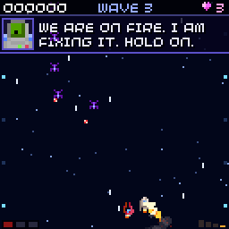
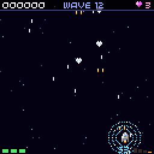
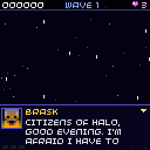
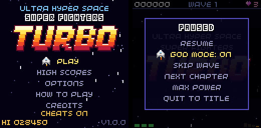

# Ultra Hyper Space Super Fighters TURBO

[](https://github.com/chili-chip/chili-space-fighter/actions/workflows/build.yml)

The galaxy is in danger! The evil aliens are invading and it's up to you to stop them.

A vertical arcade shooter for the [VGC Zero](https://chilichip.eu) (128x128), built on the
[chili-chip fork of the 32blit SDK](https://github.com/chili-chip/32blit-sdk). It also runs on
desktop (SDL) and in the browser: **[play it on the web](https://space-fighter-game.chilichip.eu/)**.

## Features

- Two modes: **Story** (six chapters with a boss each and a cast of ten, told between waves) and
  **Endless** (waves forever, for the high score table)
- Endless numbered waves built from enemy formations: dives, zig-zags, swoops, loops, side sweeps,
  squadrons that hover in formation before diving at you, and from wave 5 on figures of eight,
  V formations that dive at you, and rows that strafe side to side and stop to fire
- Five enemy types with their own fire patterns, getting faster and tougher every wave
- A boss every tenth wave, each with its own attacks (fans, aimed bursts, spirals, rings, egg rain and
  beams) and an enraged second phase. Between attacks a boss may shake, flash and dash over your
  column, more often when enraged
- Power-ups: weapon level (twin, spread, quad, max), rapid fire, shield, repair, extra life and bonus coins.
  Shields stack up to 3 layers: each hit pops one, and the HUD shows the count next to the S
- Losing a life does not destroy the ship (only the last one does). It catches fire for 2.5 s: no
  hits, no firing, half speed, while the ship computer repairs it and the hull fills up again
- Combo multiplier for chaining kills, no-hit wave bonus, extra life every 10,000 points
- Top-5 high score table with three-letter names, saved on the device
- Six music tracks that change with the situation (title, two stage themes, boss, story scenes,
  ending), converted from public domain tracker songs into note sheets for the built-in chiptune player
- Five ship colours to pick from in Options; music and sound can be switched off separately

|  |  |
| --- | --- |
| A life lost: the ship burns while the ship computer fixes it | Three shield layers, `S3` in the HUD |

## Story

**PLAY > STORY** tells **Open Sky** in scenes between waves: six chapters of ten waves each, each
with its own background, then the ending. Each speech appears letter by letter while the speaker's face talks and blips. A shows the
whole page, then the next one; B skips a scene. After a game over, A retries the chapter. Story runs
do not go in the high score table; **PLAY > ENDLESS** is the arcade game with high scores.

Story mode adjusts to the player like a rubber band. One difficulty number scales enemy fire rate
and speed and the boss's pace. Endless mode does not use it.

| | Difficulty |
| --- | --- |
| Start of a story run | 1.0 |
| A life lost | -0.1 |
| A chapter retried after a game over | -0.1 |
| A wave or boss cleared without a hit | +0.05 |
| Lowest / highest | 0.7 / 1.15 |

See [Difficulty](docs/story/index.md#difficulty) for more.

The world, the cast from `assets/characters.png`, the ships and the full script are in
[docs/story](docs/story/index.md). The dialogue lives only in
[docs/story/script.md](docs/story/script.md); the build turns it into code, so to change a line,
edit the script and build. See [Changing the dialogue](docs/story/index.md#changing-the-dialogue).



## Controls

| Button | Action |
| --- | --- |
| D-pad | Fly |
| A (hold) | Fire |
| MENU | Pause |
| A / B | Confirm / back in menus |
| A / B in a story scene | Next page / skip the scene |

On desktop the keyboard maps to: arrows or WASD for the D-pad, `Z` for A, `X` for B and `Esc` or `2` for MENU.

## Cheats

Cheats make testing faster. On the title screen press **left, left, right, right, left, right,
left, right, B** (on desktop: arrows, then `X`). A sound plays and the title shows CHEATS ON. The
same code turns them off again. They last until the game is closed and are not saved.



With cheats on, the pause menu (MENU) has more items:

| Item | What it does |
| --- | --- |
| GOD MODE | Nothing can hit you: bullets, beams and ramming do no damage. Stays on between runs |
| SKIP WAVE | Destroys every enemy left in the wave, or the boss, as if you had shot them. The wave then clears as usual, with its story scene |
| NEXT CHAPTER | Story mode only, chapters 1 to 5: starts the next chapter from its card |
| MAX POWER | Weapon level 4, three shields, rapid fire, full hull and 9 lives |

B still skips a story scene, so a whole chapter can be checked in a minute or two.

## Building

You need the [chili-chip 32blit SDK](https://github.com/chili-chip/32blit-sdk) checked out next to this repository.

Desktop (SDL):

```
mkdir build
cd build
cmake -D32BLIT_DIR=../../32blit-sdk ..
make
./game.elf
```

VGC Zero:

```
mkdir build.vgc
cd build.vgc
cmake .. \
  -D32BLIT_DIR=../../32blit-sdk \
  -DPICO_SDK_PATH=../../pico-sdk \
  -DPICO_BOARD=chilichip_vgc \
  -DPICO_PLATFORM=rp2350-arm-s \
  -DCMAKE_TOOLCHAIN_FILE=../../32blit-sdk/pico2.toolchain
make
```
To build an installable `.blit` for the VGC Zero loader instead of a standalone `.uf2`, add
`-DBLIT_EXECUTABLE_PICO_BLIT=1` to the vgc cmake command (or use the `vgc-blit` preset), then install it over USB with
`32blit install game.blit`. The console needs the loader flashed first; see the
[loader instructions](https://github.com/chili-chip/32blit-sdk/blob/master/docs/vgc.md#loader-and-blit-games-os-preview).

[detailed instructions for vgc](https://github.com/chili-chip/32blit-sdk/blob/master/docs/vgc.md)

See the [VGC build docs](https://github.com/chili-chip/32blit-sdk/blob/master/docs/vgc.md) for flashing.
The web build is produced by CI with Emscripten and deployed from `main`.

## Code layout

| File | What it does |
| --- | --- |
| `src/game.cpp` | 32blit entry points, title screen, menus, pause, cheats, game over and name entry |
| `src/world.cpp` | One run: wave schedule, collisions, scoring, HUD, banners, story difficulty, the convoy and when story scenes play |
| `src/story.cpp` | Story text box: wrapping, sentence-aware pages, portraits, comms static and title cards; the small repair comms box |
| `src/player.cpp` | Player ship, weapons, hull, stacked shields, the repair after a lost life, the autopilot during scenes, and the wingman (Rook, then Juno) |
| `src/enemy.cpp` | Enemy types, movement patterns and the six bosses with their attacks (including beams) |
| `src/powerup.cpp` | Power-up drops |
| `src/projectile_manager.cpp` | Bullet pool |
| `src/fx.cpp` | Explosions, particles, score popups and screen shake |
| `src/starfield.cpp` | Parallax starfield and the background of each story chapter |
| `src/audio.cpp` | Chiptune sequencer, sound effects and talking blips |
| `src/songs.cpp` | The six songs as note sheets, made by `tools/mod_to_song.py` |
| `src/save.cpp` | Settings and high scores |
| `tools/make_art.py` | Regenerates the TURBO logo, launcher splash and icon |
| `tools/make_script.py` | Turns `docs/story/script.md` into `story_script.cpp` at build time |
| `tools/mod_to_song.py` | Converts the public domain tracker songs into note sheets in `src/songs.cpp` |

## Credits

Game by teriyakigod / [Chili Chip](https://chilichip.eu). Sound effects are synthesised in code and
released under the same MIT licence as the code.

The music is arranged from public domain ProTracker songs on [The Mod Archive](https://modarchive.org).
The game does not play the song files: `tools/mod_to_song.py` turns each one into four note sheets
(lead, bass, arp, drums) for the game's own chiptune player.

| Where it plays | Song | Author |
| --- | --- | --- |
| Title screen | [XLR8](https://modarchive.org/module.php?205968) | Jam |
| Stages, chapters 1, 3, 5 (and every other ten waves in endless) | [Highway Encounter](https://modarchive.org/module.php?211660) | Jam |
| Stages, chapters 2, 4, 6 | [8-bit Castle](https://modarchive.org/module.php?195782) | Jam |
| Boss fights | [May is 4 Her](https://modarchive.org/module.php?197296) | Drozerix |
| Story scenes | [heatwave cruise](https://modarchive.org/module.php?208535) | Jam |
| Ending and credits | [late night coffee](https://modarchive.org/module.php?208532) | Jam |

The sprites in `assets/ships.png`, `characters.png`, `projectiles.png`, `ui.png` and `misc.png`
come from the [8x8 Space Shooter Asset Pack](https://gvituri.itch.io/space-shooter) by
Gustavo Vituri. They are not under the MIT licence. The pack allows use and changes in personal
and commercial games, but not passing the files on as an asset pack, so do not reuse them
outside this game. The logo, splash and icon are made by `tools/make_art.py`.
