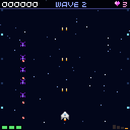
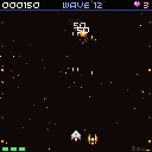
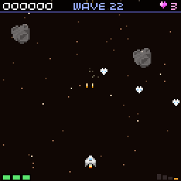
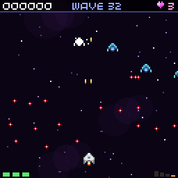
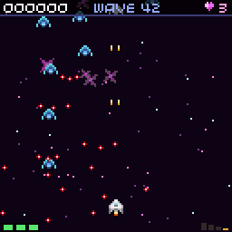
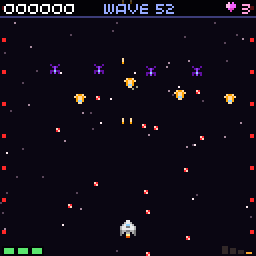

# Backgrounds

Each story chapter has its own background, so the player can tell where the story is without
reading. Endless mode and the menus keep the plain starfield.

For now every background is drawn in code (`src/starfield.cpp`): a sky colour, three layers of
stars, and a few props taken from sprites the game already has in `assets/misc.png`. The props are
drawn at 60% opacity so they read as scenery, never as something to shoot or dodge. The table at the
end lists the new art each place needs to look finished.

## What each chapter shows now

| Chapter | Place | Screenshot | Sky and stars | Props |
| --- | --- | --- | --- | --- |
| 1. The Show | Halo Station |  | Clean dark blue, cool white stars | Cyan lane lights along both edges, blinking in a running pattern |
| 2. No Papers | The Tollgate |  | Warm brown haze, amber stars | Gate rings (misc 63, 16x16) drifting down, amber warning lights on both edges |
| 3. The Yards | The Rust Ring |  | Rust brown, dusty stars | Big and small rocks (misc 28 at 16x16, misc 40 at 8x8), flipped at random, at different speeds |
| 4. Old Wings | The Drift |  | Deep purple, lilac stars | Slow soft gas clouds, drawn as overlapping see-through circles |
| 5. The Signal | Glimmer |  | Dark magenta, pink and cyan stars | Pink crystal sparkles (misc 84 to 86) that twinkle through three frames |
| 6. Open Sky | Halo Station in lockdown |  | Dark, so the red enemy bullets still show | Red alarm lights flashing together on both edges, shut gate rings (misc 61) |

The background changes on the chapter card, at the first wave of the chapter. A retried chapter
starts with its own background. To change one, edit `THEMES` in `src/starfield.cpp`.

## Sprites needed

New art that would replace the code-drawn props. Sizes are in console pixels. The sheet column
says where it would go; a new `assets/backgrounds.png` keeps the existing sheets as they are.

| Chapter | Sprite | Size | Frames | What it shows | Sheet |
| --- | --- | --- | --- | --- | --- |
| All | Star layer tiles | 8x8 | 4 | Small, medium and bright stars with a twinkle, to replace single pixels | backgrounds |
| 1 | Halo Station hull edge | 16x16 | 2 (left, right) | Station hull panels scrolling past at both sides, with windows | backgrounds |
| 1 | Lane beacon | 8x8 | 4 | The lane light that blinks along the edges | backgrounds |
| 1 | Studio camera drone | 8x8 | 2 | Show cameras floating in the far layer, filming the fight | backgrounds |
| 1 | Holo billboard | 32x16 | 2 | A big TURBO advert screen drifting past | backgrounds |
| 2 | Tollgate pillar | 16x32 | 1 (flip for the other side) | The gate's pillars at the screen edges | backgrounds |
| 2 | Gate arch | 32x16 | 2 (open, closed) | The arch the convoy flies through | backgrounds |
| 2 | Warning light | 8x8 | 4 | Amber rotating light on the pillars | backgrounds |
| 2 | Convoy ship | 8x8 | 2 | The families' old ships, far away in the back layer | ships or backgrounds |
| 3 | Rust asteroids | 16x16 | 3 kinds | Brown and orange rocks, to replace the grey ones | backgrounds |
| 3 | Factory crane | 32x16 | 1 | Yards cranes and frames in the far layer | backgrounds |
| 3 | Conveyor with drones | 32x8 | 2 | Half-built Wardens on a line, stopped after the boss | backgrounds |
| 4 | Nebula cloud | 32x32 | 2 kinds | Purple and pink gas, to replace the circles | backgrounds |
| 4 | Ship wrecks | 16x16 | 3 kinds | Old Static fighters from Ossa's war drifting by | backgrounds |
| 4 | The Hollow | 32x32 | 1 | The hidden base in a big rock, seen once at the start | backgrounds |
| 5 | Glimmer moon edge | 64x32 | 1 | The crystal moon's surface at the bottom of the far layer | backgrounds |
| 5 | Crystal spires | 16x16 | 3 kinds | Pink and cyan crystals, to replace the reused sparkles | backgrounds |
| 5 | Signal ripple | 16x16 | 4 | The Prism's jamming waves, gone after the boss | backgrounds |
| 6 | Locked gate | 32x16 | 2 (red shut, green open) | The seven gates; they turn green in the ending | backgrounds |
| 6 | Alarm light | 8x8 | 4 | Red rotating light, to replace the squares | backgrounds |
| 6 | Crowd lights | 16x8 | 2 | Lights of people in the docks below, in the far layer | backgrounds |

Art for the game has to be made by people (no AI-generated assets) and needs a licence that lets it
ship in the game; credit the artist in the README and the credits screen.
