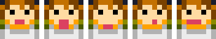
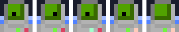
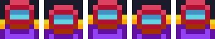
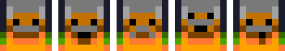
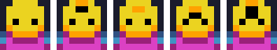
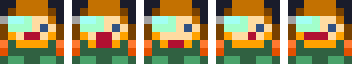
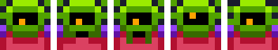
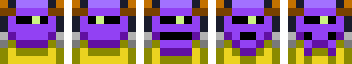
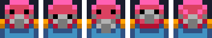
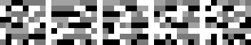

# Characters

Every character uses one row of `assets/characters.png`. A row has five 8 by 8 frames. The script
writes a box as `[NAME FRAME]`, for example `[NOVA 1]`.

The sheet is 42 by 88 pixels with a 1 pixel border on the left. Frame `f` of row `r` is at
x = `1 + f * 8`, y = `r * 8`.

| Row | Name | People | Side | First seen |
| --- | --- | --- | --- | --- |
| 8 | **Nova** | Human | TURBO, then the Static | Intro |
| 1 | **AUX-7 / Kit** | Ship computer | Nova's ship | Intro |
| 2 | **Rook** | Human | TURBO wing lead | Intro |
| 0 | **Marshal Brask** | Human | The Concord | Intro |
| 7 | **DJ Lumo** | Sunn | The Static | Chapter 1 |
| 4 | **Juno** | Human (Outlander) | Runner | Chapter 2 |
| 3 | **Zix** | Vrill | Yards engineer | Chapter 3 |
| 6 | **Ossa** | Korr | Leader of the Static | Chapter 4 |
| 9 | **Doc** | Pell | The Static | Chapter 4 |
| 5 | **Wisp** | Glim | Glimmer miner | Chapter 5 |
| 10 | Static frame | none | The Static's signal | Chapter 1 |

## Nova

Frames: 0 smile, 1 shout, 2 calm, 3 worried, 4 grin.

The player. The newest TURBO pilot, still in the white Concord uniform. Nova grew up on Halo
watching the show and believed every episode. Nova is brave and a bit naive, and honest to a fault.

- **Wants:** to be a hero, like on the show.
- **Learns:** that being a hero can mean saying no to the people who made the show.
- **Arc (acceptance):** Nova has to face the fear the show put in them, most of all when meeting
  Zix. Nova gets it wrong once, says sorry and does better.
- The player picks any ship colour. Nova flies it. The story does not change.

## AUX-7, later Kit

Frames: 0 to 3 the eye looks around (0 centre, 1 up, 2 right, 3 left), 4 screen off (thinking).

The computer in Nova's fighter, issued by the Concord. Polite, exact and quietly funny. It is the one
that scans the "mothership" in chapter 1 and finds the truth.

- **Wants:** at first, nothing. It follows orders.
- **Arc (freedom):** in chapter 5 the Prism sends a Concord override to every ship computer. AUX-7
  could obey. It chooses not to, and asks to be called **Kit**. From then on the script uses
  `[KIT n]`.
- Kit never becomes a person in a body. The point is the choice, not the upgrade.

## Rook

Frames: 0 neutral, 1 visor bright (talking), 2 visor dim, 3 visor narrow (angry), 4 visor flat
(tired).

TURBO wing lead, the face of the show. Nobody has seen Rook without the red helmet. Rook is a great
pilot and a true believer: the Concord took Rook out of a hard life and gave a uniform and a name.

- **Wants:** order, and to deserve the uniform.
- **Arc (acceptance, redemption):** Rook hunts Nova in chapter 4 in the Paragon and loses. Doc
  treats Rook. Rook expects a cell and gets an open door instead. In chapter 6 Rook flies the
  Crimson fighter at Nova's side.
- Rook keeps the helmet on to the end. Who is under it is Rook's business.

## Marshal Brask

Frames: 0 neutral, 1 talking, 2 frown, 3 shouting, 4 smirk.

Head of Lane Security and producer of the TURBO show. A war veteran with a grey helmet and a grey
moustache. Brask is not a monster. He truly thinks fear keeps people safe, and that the lie is a
small price. That makes him dangerous.

- **Wants:** safe Lanes, clear papers, good ratings.
- **Ends:** his flagship falls, and the people of Halo, not the squad, take him to trial.
- Brask only appears on comms until chapter 6.

## DJ Lumo

Frames: 0 neutral, 1 eyebrows up, 2 cheerful, 3 cross, 4 shocked.

The voice of the Static. A Sunn who broadcasts from a stolen relay in the Hollow. Lumo makes jokes,
plays music, and between songs reads the names of people taken to the Yards.

- **Wants:** everyone on Halo to hear the truth.
- Lumo delivers the `radio` lines and the [Free Lanes](script.md#free-lanes) lines.
- Every Lumo box starts with a static frame before the face, like a channel being tuned.

## Juno

Frames: 0 neutral, 1 talking, 2 calm, 3 serious, 4 smile.

A human runner, born in the Yards. Juno has no papers and never had any. Juno flies an old cargo
skiff and smuggles Outlander families past the Tollgate. The cyan lens over one eye is a Yards work
scanner Juno never took off.

- **Wants:** to get people out. Nothing else.
- **Arc (acceptance):** Juno does not trust a Concord pilot, and says so. By the end of chapter 2
  Nova has earned a little trust. By chapter 6 they are friends.
- Juno is proof that the line is papers, not species.

## Zix

Frames: 0 neutral, 1 talking, 2 laughing, 3 eyes narrowed, 4 calm.

A Vrill engineer in the Yards. Zix builds Warden drones all day and knows them better than the
Concord does. The show's "Swarm" was drawn from the Vrill, so Zix has been feared on sight for
five years.

- **Wants:** to stop building cages, and to be seen as Zix.
- **Arc (acceptance):** when they meet, Nova flinches. Zix has seen that flinch a thousand times.
  Zix does not make a speech. Zix just waits to see what Nova does next.
- Later Zix tunes the Static's fighters and fixes Nova's ship between chapters.

## Ossa

Frames: 0 neutral, 1 talking, 2 shouting, 3 grim smile, 4 stern.

Leader of the Static. A Korr pilot who flew in the Lane Wars, for the side that lost. Ossa is old,
patient and very hard to impress.

- **Wants:** open gates. Not revenge, not power.
- Ossa is the one who decides Rook gets a second chance. *"DOORS STAY OPEN."*

## Doc

Frames: 0 neutral, 1 smile, 2 concerned, 3 talking, 4 cheeky.

A Pell medic at the Hollow. Wears a grey breather because Halo air is too thin for Pell. Treats
anyone who comes through the door, Static or Concord.

- **Wants:** fewer patients.
- Doc patches up Rook in chapter 4 and is the first to talk to Rook as a person.

## Wisp

Frames: 0 dim, 1 glowing, 2 dim, 3 bright (talking), 4 faint.

A Glim crystal miner on Glimmer. Glim speak with light, so Kit translates. Wisp's lines are shown
in brackets: `[WISP 3]` then the translated text.

- **Wants:** the mining to stop, and Glimmer to stop being a jammer.
- Wisp guides Nova to the weak point of the Prism. *"THE MOON WANTS TO SING AGAIN."*

## The static frame

Row 10 is TV noise. It is used for `[STATIC]` boxes: a voice nobody can see yet, a jammed signal,
or the tune-in before Lumo talks. Animate it by cycling the five frames.

## Who changes

| Character | Starts | Ends | Theme |
| --- | --- | --- | --- |
| Nova | Believes the show | Tells the truth on it | Resistance |
| AUX-7 | Obeys | Chooses, is named Kit | Freedom |
| Rook | Hunts Nova | Flies with Nova | Acceptance |
| Juno | Trusts no one in white | Trusts Nova | Acceptance |
| Zix | Builds cages | Builds wings | Freedom |
| People of Halo | Afraid of the Swarm | Open the gates | Acceptance |
| Brask | Writes the story | Faces a trial | Oppression ends |
