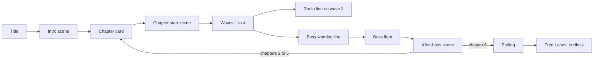

# Story: Open Sky

This is the story, lore and world of **Ultra Hyper Space Super Fighters TURBO**. It is written to be
added to the game later. Nothing here is in the game yet.

| Page | What is in it |
| --- | --- |
| [World](world.md) | The Halcyon system, the Concord, the Lanes, the peoples, history and a glossary |
| [Characters](characters.md) | The ten portraits in `assets/characters.png`: who they are, what they want, how they change |
| [Ships](ships.md) | Player fighters, Warden drones and the six bosses in `assets/ships.png` |
| [Script](script.md) | Every line of dialogue, chapter by chapter, in the format the console will show |

## The story in one minute

The game opens the way it always has: *"The galaxy is in danger! The evil aliens are invading!"*

That line is a lie, and the story is about finding that out.

**ULTRA HYPER SPACE SUPER FIGHTERS TURBO** is a holo-show. The Concord, the government of the
Halcyon system, streams it to every screen on Halo Station. Five pilots in shiny fighters blast
"the Swarm", an alien horde that is always about to invade. You are **Nova**, the newest pilot on
the show.

In your first episode you shoot down the alien mothership. Your ship computer scans the wreck. There
is no crew. There are cameras, and Concord serial numbers. The invasion was staged. The "aliens"
were Concord drones dressed up for the show.

The real aliens are not invading anyone. They live in work camps called the Yards, with the humans
who have no **Lane Papers**. Without papers you cannot travel, work outside the Yards or vote. The
Concord keeps the show running so citizens stay afraid of the people it locks up.

Nova refuses to delete the scan, and becomes the Concord's most wanted. A pirate radio called
**the Static** takes Nova in. Over six chapters Nova breaks the Tollgate, frees the drone Yards,
faces an old wingmate, brings down the jammer that keeps Halo deaf, and flies against the flagship
of the man who wrote the lie.

At the end the Lanes open. The squad keeps the silly name. *"They made it a lie. We make it true."*

## Themes

The game is an arcade shooter, so the themes live in short lines between waves. They are shown
through what characters do, not through speeches.

| Theme | Where it shows |
| --- | --- |
| **Oppression** | Lane Papers decide who may move. The Yards make Outlanders build the drones that cage them. The show turns neighbours into villains. |
| **Resistance** | The Static is a radio first and a fleet second. Its weapon is the truth: the scan from chapter 1. Every boss is a tool of control (a lie, a gate, a factory, a loyal soldier, a jammer, a flagship). |
| **Freedom** | Free travel (the Tollgate), free work (the Yards), free speech (the Prism), free will (the ship computer chooses its own name). |
| **Acceptance** | Juno learns to trust a Concord deserter. Nova unlearns the fear the show taught. Zix lets Nova try again. The Static gives Rook a second chance. Nobody is asked to be less of who they are. |

Tone: hopeful and a bit funny, like the title. The Concord is a system, not a species. Humans are on
both sides, and so are aliens. Nobody's people are "the evil ones". The player only ever shoots
**unmanned Warden drones** and machines; every pilot in a boss ship gets out alive.

## How the story fits the game

The game already has endless waves with a boss every fifth wave, and six boss sprites that loop.
The story uses that shape and adds no new gameplay.

| Waves | Chapter | Place | Boss |
| --- | --- | --- | --- |
| 1 to 5 | 1. The Show | Halo Station | The Herald |
| 6 to 10 | 2. No Papers | The Tollgate | The Tollgate |
| 11 to 15 | 3. The Yards | The Rust Ring | The Cradle |
| 16 to 20 | 4. Old Wings | The Drift | The Paragon (Rook) |
| 21 to 25 | 5. The Signal | Glimmer | The Prism |
| 26 to 30 | 6. Open Sky | Halo Station | The Bulwark (Brask) |
| 31 and on | Free Lanes | Anywhere | All six, looping |



### Scene hooks

Each scene in the [script](script.md) has a hook name. These are the only places the game needs to
show story.

| Hook | When | Length |
| --- | --- | --- |
| `intro` | After PLAY, before wave 1 | 6 to 10 boxes |
| `chapter_card` | Replaces "WAVE N / GET READY" on the first wave of a chapter | Title + place |
| `chapter_start` | After the chapter card, before the first wave (chapters 2 to 6) | 4 to 7 boxes |
| `radio` | Start of the third wave of a chapter | 1 to 2 boxes |
| `boss_warning` | During "WARNING / BOSS APPROACHING" | 1 box |
| `after_boss` | After a boss dies, before the next wave | 3 to 8 boxes |
| `game_over` | Under "GAME OVER" in story chapters | 1 box |
| `ending` | After the chapter 6 boss | 8 to 12 boxes |
| `free_lanes` | Start of each boss wave from wave 35 on, picked in order | 1 box |

Score, combos, power-ups and the high score table stay as they are. The story never stops the player
for more than a few button presses, and **B skips** a scene.

## Writing for the console

The console screen is 128 by 128 pixels. Dialogue uses a box along the bottom of the screen.

```
+--------------------------------+
|                                |
|          (game paused)         |
|                                |
+------+-------------------------+
| face | ROOK                    |
| 16x16| STAY IN FORMATION,      |
|      | ROOKIE. CAMERAS ARE     |
|      | ROLLING.                |
+------+-------------------------+
```

- Portraits are 8 by 8 sprites from `assets/characters.png`, drawn at 2x (16 by 16).
- Text uses `minimal_font`, in capitals like the rest of the game's UI.
- **18 characters per line at most**, **3 lines per box at most**. Wrap by hand in the script.
- The widest line in the script is 97 pixels in `minimal_font`. The text area next to the portrait is 104 pixels.
- One thought per box. A then moves on.
- No names the player has to remember before they matter. Each new name is said next to a face.
- Avoid words that only make sense with a long backstory. If a box needs a footnote, cut it.

### Script format

Every box in [script.md](script.md) looks like this, so a small tool can turn it into C++ arrays
later:

```text
[ROOK 1]
STAY IN FORMATION,
ROOKIE. CAMERAS ARE
ROLLING.
```

The first line is the speaker and the portrait frame (0 to 4, see [Characters](characters.md)).
`[STATIC]` means no face: draw the static frame (row 10 of the sheet). Lines in `( )` are stage
directions for the game, not text.

## Not in this story

- No new mechanics, weapons or enemies. Everything uses the existing sprites.
- No branching or saves for story progress. A run is one telling of the story.
- No real-world groups, flags or slogans. The themes stay in a made-up world on purpose.
