# Story: Open Sky

This is the story, lore and world of **Ultra Hyper Space Super Fighters TURBO**. The game plays the
[script](script.md) between waves; see [In the game](#in-the-game) for how it looks and how to
change it.

| Page | What is in it |
| --- | --- |
| [World](world.md) | The Halcyon system, the Concord, the Lanes, the peoples, history and a glossary |
| [Characters](characters.md) | The ten portraits in `assets/characters.png`: who they are, what they want, how they change |
| [Ships](ships.md) | Player fighters, Warden drones and the six bosses in `assets/ships.png` |
| [Script](script.md) | Every line of dialogue, chapter by chapter, in the format the console will show |
| [Backgrounds](backgrounds.md) | The background of each chapter, and the sprites needed to replace the code-drawn props |

## The story in one minute

The game opens the way it always has: *"The galaxy is in danger! The evil aliens are invading!"*

That line is a lie, and the story is about finding that out.

**ULTRA HYPER SPACE SUPER FIGHTERS TURBO** is a holo-show. The Concord, the government of the
Halcyon system, streams it to every screen on Halo Station. Five pilots in shiny fighters blast
"the Swarm", an alien horde that is always about to invade. You are **Nova**, the newest pilot on
the show.

In your first episode you shoot down the alien mothership. Your ship computer scans the wreck. There
is no crew. There are cameras, and Concord serial numbers. The invasion was staged. The "aliens"
were Concord drones dressed up for the show.

The real aliens are not invading anyone. They live in work camps called the Yards, with the humans
who have no **Lane Papers**. Without papers you cannot travel, work outside the Yards or vote. The
Concord keeps the show running so citizens stay afraid of the people it locks up.

Nova refuses to delete the scan, and becomes the Concord's most wanted. A pirate radio called
**the Static** takes Nova in. Over six chapters Nova breaks the Tollgate, frees the drone Yards,
faces an old wingmate, brings down the jammer that keeps Halo deaf, and flies against the flagship
of the man who wrote the lie.

At the end the Lanes open. The squad keeps the silly name. *"They made it a lie. We make it true."*

## Themes

The game is an arcade shooter, so the themes live in the scenes between waves. They are shown
through what characters do, not through speeches.

| Theme | Where it shows |
| --- | --- |
| **Oppression** | Lane Papers decide who may move. The Yards make Outlanders build the drones that cage them. The show turns neighbours into villains. |
| **Resistance** | The Static is a radio first and a fleet second. Its weapon is the truth: the scan from chapter 1. Every boss is a tool of control (a lie, a gate, a factory, a loyal soldier, a jammer, a flagship). |
| **Freedom** | Free travel (the Tollgate), free work (the Yards), free speech (the Prism), free will (the ship computer chooses its own name). |
| **Acceptance** | Juno learns to trust a Concord deserter. Nova unlearns the fear the show taught. Zix lets Nova try again. The Static gives Rook a second chance. Nobody is asked to be less of who they are. |

Tone: hopeful and a bit funny, like the title. The Concord is a system, not a species. Humans are on
both sides, and so are aliens. Nobody's people are "the evil ones". The player only ever shoots
**unmanned Warden drones** and machines; every pilot in a boss ship gets out alive.

## How the story fits the game

The game has endless waves with a boss every tenth wave, and six boss sprites that loop. A chapter
is ten waves with its boss at the end.

| Waves | Chapter | Place | Boss |
| --- | --- | --- | --- |
| 1 to 10 | 1. The Show | Halo Station | The Herald |
| 11 to 20 | 2. No Papers | The Tollgate | The Tollgate |
| 21 to 30 | 3. The Yards | The Rust Ring | The Cradle |
| 31 to 40 | 4. Old Wings | The Drift | The Paragon (Rook) |
| 41 to 50 | 5. The Signal | Glimmer | The Prism |
| 51 to 60 | 6. Open Sky | Halo Station | The Bulwark (Brask) |

Each chapter has its own background; see [Backgrounds](backgrounds.md).

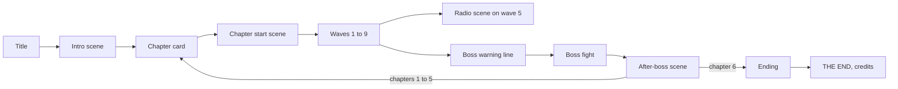

### Scene hooks

Each scene in the [script](script.md) has a hook name. These are the only places the game needs to
show story.

| Hook | When | Length |
| --- | --- | --- |
| `intro` | After PLAY, before wave 1 | 8 speeches |
| `chapter_card` | Replaces "WAVE N / GET READY" on the first wave of a chapter | Title + place |
| `chapter_start` | After the chapter card, before the first wave (chapters 2 to 6) | 4 to 7 speeches |
| `radio` | Start of the fifth wave of a chapter | 1 to 6 speeches |
| `boss_warning` | After "WARNING / BOSS APPROACHING", before the boss arrives | 1 to 2 speeches |
| `after_boss` | After a boss dies, before the next wave | 4 to 11 speeches |
| `game_over` | Under "GAME OVER" in story chapters | 1 speech |
| `ending` | After the chapter 6 boss | 9 speeches |
| `free_lanes` | Not used yet: the story ends after chapter 6, and endless mode has no story | 1 speech each |

Score, combos and power-ups stay as they are. Scenes play between waves, never during the action, and **B skips** a scene. The story is its own mode (PLAY > STORY); endless mode (PLAY > ENDLESS) has no scenes and keeps the high score table.

## Writing for the console

The console screen is 128 by 128 pixels. Dialogue uses a box along the bottom of the screen.

- Portraits are 8 by 8 sprites from `assets/characters.png`, drawn at 2x (16 by 16).
- Dialogue uses `minimal_font` in normal sentence case, so long speech is easy to read. Titles and
  chapter cards stay in capitals like the rest of the UI.
- **The script is written as natural speech, not as pre-cut lines.** The game wraps the text to the
  104 pixel text area and shows it three lines at a time (a page). A moves to the next page, B skips
  the scene.
- A speech is **3 pages at most** (about 150 characters). Longer thoughts are split into two
  speeches, often with a different portrait frame.
- Characters talk the way people talk: full sentences, their own voice, room for a joke. See the
  voice notes in [Characters](characters.md).
- Each new name is said next to a face, so the player never has to remember a name before it matters.

### Script format

Every speech in [script.md](script.md) looks like this. The build reads this file directly (see
[Changing the dialogue](#changing-the-dialogue)):

```text
[ROOK 1]
And that's our cue. Smile for the camera, rookie. There are ten million screens watching your first flight tonight.
```

The first line is the speaker and the portrait frame (0 to 4, see [Characters](characters.md)).
The second line is the whole speech on one line. `[STATIC]` means no face: draw the static frame
(row 10 of the sheet). Lines in `( )` are stage directions, not text. The game acts on one of them,
`(title card: A / B / C. D)`, which shows a full screen card with one line per part. A `( )` at the
start of a speech, like Wisp's `(the light says)`, is left out of the box.

On the console that speech becomes two pages:

```
+------+-------------------------+     +------+-------------------------+
| face | ROOK                    |     | face | ROOK                    |
| 16x16| And that's our cue.     |  A  | 16x16| ten million screens     |
|      | Smile for the camera,   | --> |      | watching your first     |
|      | rookie. There are     v |     |      | flight tonight.         |
+------+-------------------------+     +------+-------------------------+
```

The script has 120 speeches and 272 pages in total. Every speech was checked against the real
`minimal_font` character widths.

## In the game

| | |
| --- | --- |
| 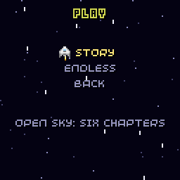 | **PLAY menu.** STORY plays Open Sky; ENDLESS is the arcade game with high scores. |
| 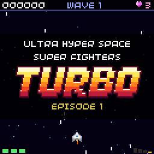 | **Title card.** The intro opens as the show. `(title card: ...)` in the script; `TURBO` is drawn as the logo. |
| 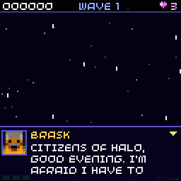 | **Dialogue box.** Face at 2x, name, three lines. The text appears letter by letter while the face talks (it switches to its talking frame and bobs) and a voice blips. The arrow means A goes on. |
| 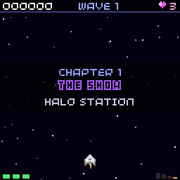 | **Chapter card.** Takes the place of "WAVE N / GET READY" on the first wave of a chapter. |
| 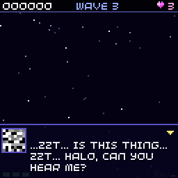 | **`[STATIC]`.** No name; the static frames flicker. |
| 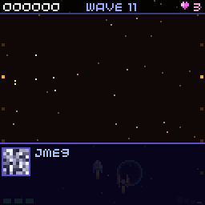 | **Comms static.** When someone new starts talking, and when the last speaker signs off, the avatar box shows snow and the name scrambles in (or out) letter by letter for 0.4 s, with a crackle. |
| 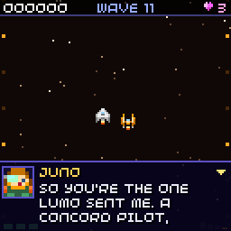 | **Autopilot and Juno.** While a scene is open the ship flies itself to the middle, above the box. In chapter 2 Juno's Sunset flies on its wing, in scenes and in the fight. |
| 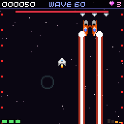 | **Beam attack.** The Tollgate, Paragon, Prism and Bulwark fire beams; the Bulwark fires one from each hull. A thin flickering line warns first. |
| 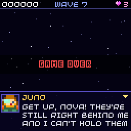 | **Game over line.** Shown under GAME OVER. A or B goes on to the score screen. |
| 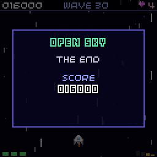 | **THE END.** After the ending scene: the score, then A for the credits. |

### When scenes play

| Hook | In the game |
| --- | --- |
| `intro` | After PLAY. Then the chapter 1 card. |
| `chapter_card` | First wave of chapters 1 to 6, for 2.6 seconds. |
| `chapter_start` | After the card, before the first enemies (chapters 2 to 6). |
| `radio` | Third wave of a chapter, after "WAVE N", before the enemies. |
| `boss_warning` | After "WARNING / BOSS APPROACHING", before the boss flies in. |
| `after_boss` | After "WAVE CLEAR!" on a boss wave, before the next wave. |
| `ending` | After the chapter 6 `after_boss`. Then THE END with the score, and the credits. |
| `game_over` | Under the GAME OVER banner. Chapter 6 has none, so nothing shows there. A retries the chapter. |

- Text appears at about 35 letters a second. **A** shows the rest of the page at once, then goes to
  the next page. **B** skips the whole scene. A waits a quarter second after a page is complete, so
  a player still mashing fire does not skip it unread.
- Each character has their own voice: a short square-wave blip at their own pitch every other
  letter (the Static crackles). The talking frame for each face is in `talk_frame()` in `src/story.cpp`.
- While a scene is open the ship flies itself to the middle of the screen, above the text box, and
  does not fire. In chapter 2 Juno's Sunset flies next to it. MENU still pauses.
- A page ends at the end of a sentence. When a sentence is too long for one page, it is split after
  a comma; only a part with no comma that is still too long is split between words.
- When someone new starts talking, the avatar box shows static for 0.4 s with a crackle of noise,
  and the name arrives as scrambled letters that settle one by one, like data coming in. When the
  last speaker signs off, the same plays backwards. The static stays inside the avatar box.
- A game over in story mode restarts the chapter from its card. Story scores do not go in the
  high score table.

### Music

The music changes with the situation. All six songs are public domain tracker songs, converted to
note sheets for the game's chiptune player (see the README credits).

| Situation | Song |
| --- | --- |
| Title and menus | XLR8 (Jam) |
| Waves in chapters 1, 3, 5 | Highway Encounter (Jam) |
| Waves in chapters 2, 4, 6 | 8-bit Castle (Jam) |
| Boss warning and boss story line | silence |
| Boss fight | May is 4 Her (Drozerix) |
| Story scenes | heatwave cruise (Jam) |
| Ending, THE END and credits | late night coffee (Jam) |

### Changing the dialogue

Edit [script.md](script.md) and build. `tools/make_script.py` turns it into C++ (`story_script.cpp`
in the build folder) on every build where the script changed. Nothing else needs to change.

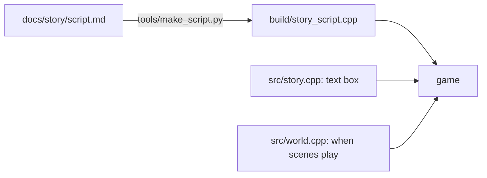

What the tool reads:

| In script.md | Becomes |
| --- | --- |
| `## Intro`, `## Ending` | the intro and ending scenes |
| `## Chapter N: ...` with `### Chapter card` | the card (first `text` block, 3 lines) and `chapter_start` (second block) |
| `### Radio`, `### Boss warning`, `### After the boss`, `### Game over` | that chapter's scene |
| `## Free Lanes` | read and checked, but not played yet |
| `[NAME FRAME]` | a speech. Names: `NOVA`, `AUX-7`, `KIT`, `ROOK`, `BRASK`, `LUMO`, `JUNO`, `ZIX`, `OSSA`, `DOC`, `WISP` |

Prose outside the `text` blocks is for people and is ignored. Any scene can be left out; the game
skips it. The build stops with the line number when a speaker is unknown, a frame is not 0 to 4, a
speech has no text, or a character is not in the console font (plain ASCII only: write `...` and
`'`, not `…` and `’`). To check the script without building the game:

```
python3 tools/make_script.py docs/story/script.md /tmp/story_script.cpp
```

The game wraps each speech itself, so a speech can be any length; keep to 3 pages so the
conversation keeps moving.

## Not in this story

- No new weapons or enemies. Everything uses the existing sprites; the backgrounds are drawn in
  code from them until new art exists ([Backgrounds](backgrounds.md) lists what is needed).
- Stage directions like "(Ossa takes the Nebula fighter)" are not acted out. The ship is still
  the one picked in Options. The one exception is Juno's Sunset, which flies on your wing in
  chapter 2.
- No branching or saves for story progress. A run is one telling of the story.
- No real-world groups, flags or slogans. The themes stay in a made-up world on purpose.
