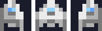
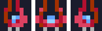
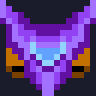
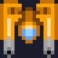
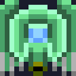
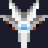
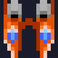

# Ships

All ships come from `assets/ships.png`, a 10 by 10 grid of 8 by 8 sprites. Sprite index =
`row * 10 + column`. Indices below match the code, so nothing has to move when the story goes in.

## TURBO fighters (player)

The five fighters were built for the show: fast, loud and very shiny. Each has three frames
(tilt left, centre, tilt right). The player picks one in Options. In the story, Nova takes the
chosen one when leaving Halo, and the others end up with the Static.

| Ship | Frames | Index (centre) | Story |
| --- | --- | --- | --- |
| **Silver** |  | 1 | The rookie's ship, Nova's by default. Plain, reliable, the show's "everyone" fighter. |
| **Sunset** |  | 11 | Grounded after its pilot quit the show. Juno takes it in chapter 2 and finally retires the old skiff. |
| **Viper** |  | 21 | Taken from a Yards test bay in chapter 3. Zix rebuilds it and flies it badly but happily. |
| **Nebula** |  | 31 | Was a show prop, never flown. Ossa takes it in chapter 4: "IT IS UGLY. I LOVE IT." |
| **Crimson** |  | 41 | Rook's ship. Grounded after chapter 4. Rook flies it again in chapter 6, on the other side. |

## Warden drones (enemies)

Every enemy in the waves is a **Warden**: an unmanned Concord drone. They are built in the Yards by
Outlanders. For the show, the Concord calls them "the Swarm". Pilots use the nicknames below.

| Sprite | Name | Index | Model | What it does in the game | Lore |
| --- | --- | --- | --- | --- | --- |
|  | **Drone** | 4 | W-1 Sentry | No gun, fast, comes in numbers | The cheapest Warden. Was a camera drone before the show. Its heart shape was designed to look "friendly". |
|  | **Bug** | 6 | W-2 Picket | Fires straight down | Lane patrol. Stops ships without papers and calls in the rest. |
|  | **Wasp** | 17 | W-3 Hunter | Fires at the player | Built to chase runners. Painted orange for the show "so the kids can see it". |
|  | **Crab** | 39 | W-4 Shell | Fires a spread | Yards guard. Its dome shield is made from Glimmer crystal. |
|  | **Tank** | 47 | W-5 Bastion | Slow, tough, fires bursts | Gate defender. The most expensive Warden. Zix calls it "a wall that flies". |

Things to keep true when the story goes in:

- Wardens have no crew. The game can show as many explosions as it likes.
- Wardens get faster and tougher every wave. In the story, that is the Concord sending more as the
  Static gets louder.

## Bosses

Each boss is a 16 by 16 sprite. The game shows them in this order and loops after six. In the story
each one is a tool of control, and each fall frees something.

| Sprite | Name | Index | Chapter | Pilot | What it controls | What its fall frees |
| --- | --- | --- | --- | --- | --- | --- |
|  | **The Herald** | 64 | 1 | None, remote from the studio | The story: a camera ship dressed as the "Swarm mothership" | The truth: Kit's scan |
|  | **The Tollgate** | 66 | 2 | None, gate AI | Movement: the gate guardian that checks papers | A convoy of Outlander families |
|  | **The Cradle** | 68 | 3 | Yards overseer (ejects) | Work: the carrier that launches Wardens from the Yards | The Yards' workers |
|  | **The Paragon** | 84 | 4 | Rook (ejects) | Loyalty: the Concord's best fighter for its best pilot | Rook, in a way |
|  | **The Prism** | 86 | 5 | None, crystal jammer | Speech: blocks the Static's signal to Halo | The signal, and Kit |
|  | **The Bulwark** | 88 | 6 | Marshal Brask (ejects, arrested) | Everything: the flagship that can lock every Lane | The Lanes |

### The Herald

A big purple wing with orange engines. Before the fight the game calls it the **ALIEN MOTHERSHIP**.
Its real name only shows after Kit's scan. Inside: cameras, lights, a fog machine.

### The Tollgate

Two orange pillars with a scanner eye between them, the gate's own guardian. Its fan of bullets is
the gate "closing". Its line: **PAPERS, PLEASE.**

### The Cradle

A green arch that carries drones and drops them like eggs. Built by Zix's team, which is why Zix
knows where to hit it.

### The Paragon

A white fighter, the pride of the Concord. Rook flies it. When it enrages (phase 2), that is Rook
taking off the safety limits. Rook ejects when it falls.

### The Prism

A pink crystal with four small crystals around it. Its spiral shots are the jamming signal made
visible. Wisp says the moon is "humming in pain" until it breaks.

### The Bulwark

Brask's flagship: two orange hulls with blue engines, the biggest ship in Halcyon. It can lock all
seven gates at once. Its phase 2 is Brask ordering every lock shut.

## Power-ups

Power-ups are supply drops from the Static, fired from runners' ships during the fight. The game
names stay. The story only adds where they come from.

| Power-up | Story |
| --- | --- |
| POWER UP | Weapon parts from Zix |
| RAPID FIRE | A cooler module stolen from a Warden |
| SHIELD | Glimmer crystal plate |
| REPAIR | Doc's patch kit |
| 1UP | A spare fighter from the Hollow |
| BONUS | Concord credits from broken drones, given to the Yards |
