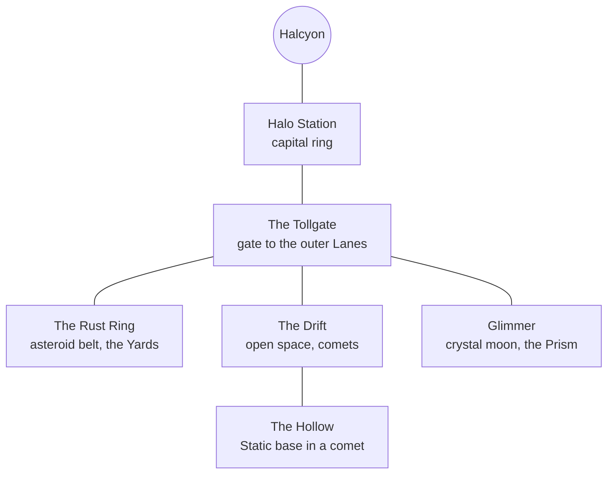

# World

## The Halcyon system

All of the game happens in one star system around the white star **Halcyon**. Travel between its
far places uses **the Lanes**: seven hyperspace routes that start and end at gates. Whoever holds
the gates decides who moves.

| Place | What it is | Chapter |
| --- | --- | --- |
| **Halo Station** | A ring city around Halcyon. Home of the Concord and its citizens. Clean, bright, full of screens that play the TURBO show. | 1, 6 |
| **The Tollgate** | The gate between Halo and the outer Lanes. Every ship shows its Lane Papers here. Ships without them are turned back or sent to the Yards. | 2 |
| **The Rust Ring** | An asteroid belt. Its rocks hold **the Yards**: work camps where Outlanders build Warden drones. | 3 |
| **The Drift** | Open, empty space full of slow comets. Concord patrols are thin here. | 4 |
| **The Hollow** | A hollowed-out comet in the Drift. Base and radio tower of the Static. | 4, 5 |
| **Glimmer** | A small moon made of glowing crystal. Home of the Glim. The Concord mines it and built the Prism on it. | 5 |

## Factions

### The Concord

The government of Halcyon. It began 80 years ago, after the Lane Wars, with a promise: *safety*.
Over time safety came to mean control.

- It decides who is a **citizen**. Citizens get **Lane Papers**: the right to travel, work and vote.
- Everyone else is an **Outlander**. Outlanders live in the Yards and work for the Concord.
- It owns every screen on Halo, and with them the TURBO show.
- Leader in this story: **Marshal Brask**, head of Lane Security and producer of the show.
- Motto, on every gate: **"SAFE LANES. CLEAR PAPERS."**

The Concord is not a species. Most citizens are human, but some aliens hold papers too, and many
humans do not.

### TURBO squadron

Five Concord pilots and five matching fighters, made for the show *Ultra Hyper Space Super Fighters
TURBO*. Concord marketing tested hundreds of names and kept every word that scored well. That is why
the name is so long.

The squad flies real missions, but the enemies are picked and the cameras are always on. At the
start of the story the squad is Nova (the rookie), Rook (wing lead) and three pilots who never
appear on screen.

### The Wardens

The Concord's drone fleet. Wardens have no pilots. They patrol the Lanes, guard the Yards and
stop ships without papers. For the show, some Wardens are painted to look like "the Swarm".
Every enemy the player shoots in the waves is a Warden. See [Ships](ships.md).

### The Static

A resistance that started as a pirate radio. Its broadcasts break into Concord screens as noise,
then a voice: **DJ Lumo**. The Static plays music, reads the names of people taken to the Yards,
and helps runners get Outlanders past the Tollgate.

- Leader: **Ossa**, an old Korr pilot who flew in the Lane Wars.
- Base: the Hollow.
- Its call: **"STAY ON THE SIGNAL."**
- Its sign on screens is the static frame itself (row 10 of `characters.png`).

The Static does not want to rule Halo. It wants the gates open and the truth on the screens.

## Peoples

Halcyon has five peoples. None of them is "the Swarm". The Swarm was made up for the show, and its
look was copied from the Vrill.

| People | Look | Who they are | In the cast |
| --- | --- | --- | --- |
| **Humans** | As you know them | The largest people in Halcyon. Some are citizens, many are not. Humans born in the Yards are Outlanders too. | Nova, Rook, Juno, Brask |
| **Vrill** | Green shell, dark face plate, small bright eyes | Builders and engineers with a hive-like family life. The show drew its villains from them, so citizens fear them on sight. | Zix |
| **Glim** | Small, hooded, a glowing gem for a face | Quiet people from Glimmer. They speak with light. Their moon is mined for crystal. | Wisp |
| **Korr** | Large, purple, horned, heavy plating | A people of old pilots and travellers. Many fought in the Lane Wars on both sides. | Ossa |
| **Sunn** | Round, yellow, cheerful | Live on the warm moons near Halcyon. Loud, musical, hard to scare. | Lumo |
| **Pell** | Pink, wear a grey breather on Halo air | From a world with thick air. Known as healers. | Doc |

## History

| When | What happened |
| --- | --- |
| 80 years ago | **The Lane Wars.** Gate holders fight over the Lanes. The Concord ends the war and takes all seven gates "for safety". |
| 60 years ago | **The Papers Act.** Only registered citizens may cross a gate. Families on the wrong side of a gate that day become Outlanders. |
| 40 years ago | **The Yards open** in the Rust Ring. Outlanders are moved there "for work and housing". |
| 20 years ago | **The Wardens.** Drones replace human patrols. Outlanders in the Yards are made to build them. |
| 5 years ago | **The TURBO show** starts. "The Swarm" first appears. Fear of Outlanders grows; the Concord asks for more Wardens and gets them. |
| 1 year ago | **The Static** starts to broadcast. The Concord calls it "Swarm noise". |
| Now | Nova flies a first episode. The story begins. |

## How the world works (for writers)

- **Papers are the wall.** Every unfair thing in the story comes back to who has papers. Keep it
  concrete: a gate that will not open, a name read on the radio, a camp.
- **Screens are the weapon.** The Concord wins with a story, not with guns. The Static fights back
  with a better one: the truth.
- **Drones, not people.** Wardens are machines. The player can fire freely without the story
  turning dark. Boss pilots always survive.
- **Change is possible.** Rook, Nova and the people of Halo all change their minds. Nobody is
  beyond a second chance, and nobody is forced to give one.

## Glossary

| Word | Meaning |
| --- | --- |
| **Lane** | A hyperspace route between two gates. Halcyon has seven. |
| **Lane Papers** | The pass that lets a citizen cross a gate. Short: papers. |
| **Outlander** | Anyone without papers, of any people. |
| **The Swarm** | The show's fake alien enemy. A slur when said about the Vrill. |
| **Warden** | A Concord drone. Five models, see [Ships](ships.md). |
| **The Static** | The resistance and its pirate radio. |
| **Runner** | A pilot who smuggles Outlanders past gates. |
| **The Yards** | The work camps in the Rust Ring. |
| **Halo** | Short for Halo Station. |
| **TURBO** | The show, the squadron, and later what the free pilots call themselves. |
